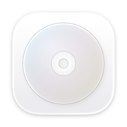
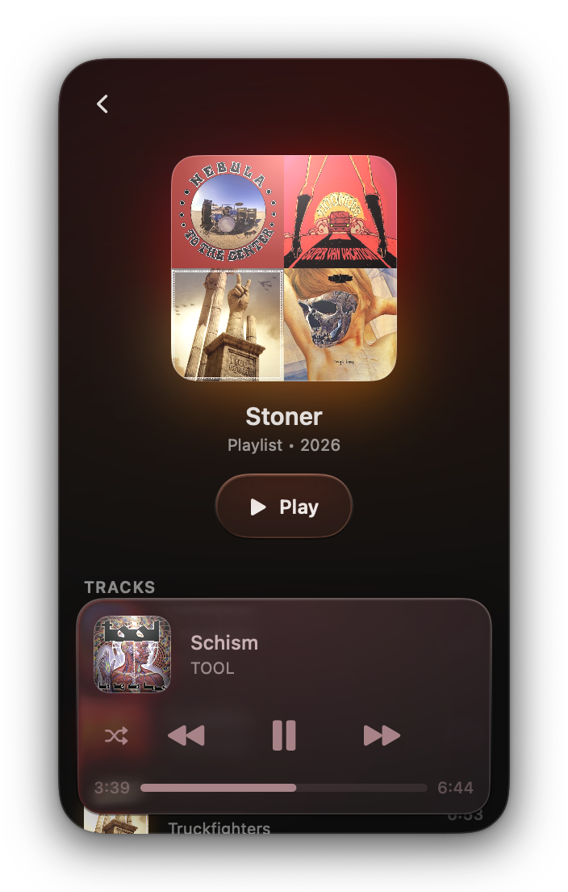

# Lilt

A small native macOS player for YouTube Music: one Liquid Glass column that lives on the edge of your screen. Search, browse, play, and get back to work.

## What it is

Lilt is deliberately light. It plays through a hidden YouTube Music web view (so your subscription, DRM and history all work as normal) and talks to the same API the site uses for search, browsing and your library. Everything you see is native SwiftUI and AppKit: no browser chrome, no web UI, nothing that fights the content behind it.



## Features

- **Edge panel** — A borderless glass column that stays out of the way of tiling and window managers, resizes from its visible edges, and never steals focus when you hit play
- **Search and browse** — Songs, albums, artists and playlists; artist and album names are links wherever they appear, and pages hand off with a subtle slide
- **Home and library** — Your YouTube Music home feed (blended across your channels), liked songs, playlists, albums and artists, cached so switching views is instant
- **Now playing platter** — Artwork, marquee title, transport, shuffle and repeat, and a scrubber; everything takes a quiet tint from the cover, and the colour slides to the next song's rather than cutting
- **Up next** — Hover a row to add it to the queue; double-click the platter to see what's queued, drag to reorder, remove on hover, click to jump
- **Mini player** — Collapse to just the platter; clicking the artwork or artist expands it again
- **Artwork finish** — A spotlight, an adaptive hairline keyline and ambient shadows in the cover's own colours; the playing track's cover turns into a spinning disc with music notes drifting out of it
- **Progressive blur** — Headers sit on a real blur ramp (a Core Animation backdrop, with a system-material fallback)
- **Dock icon** — The app icon carries the current cover on its disc, with the cover's colour on the plate
- **Recents** — Recently played tracks and recently viewed pages, one click away from the search field
- **Picks up where you left off** — Queue, playhead, view and window size survive relaunches

## Tweak panel

Debug builds include a panel (`⌥⌘T`) with live sliders for every finish value: spotlight, keyline, ambient shadows, platter tint, play-capsule cast, music notes, header blur, page ambient and the Dock tile. **Copy values** puts a Swift snippet on the clipboard to paste back into `ArtworkStyle` as the new defaults.

## Shortcuts

| Shortcut | Action |
| --- | --- |
| `⌘⇧L` | Show Lilt |
| `⌘W` | Hide |
| `⌘⇧M` | Mini player |
| `⌘L` | Library |
| `⌘[` | Back |
| `⌥⌘T` | Tweak panel (debug builds) |

## Build from source

Requires macOS 26, Xcode 26 and [xcodegen](https://github.com/yonaskolb/XcodeGen).

```
git clone https://github.com/msllrs/lilt.git
cd lilt
make run
```

`make build`, `make test` and `make open` (generates and opens the Xcode project) are also there. The project is signed ad hoc; sign in to YouTube Music on first launch.

## How it works

- Playback runs in a 1×1 `WKWebView` tucked inside the glass. Track changes dispatch YouTube Music's own in-app navigation event, so switching songs takes about a quarter of a second rather than a page load.
- Search, browse, home and library come from InnerTube, the JSON API behind the site, authenticated with the web view's cookies. Account switching is supported.
- The window is a non-activating `NSPanel` with the system shadow off and its own drawn in a transparent margin, so Liquid Glass can be the only edge.

## Acknowledgements

Modelled on [kaset](https://github.com/sozercan/kaset), which proved the approach.

© 2026 Matt Sellers
